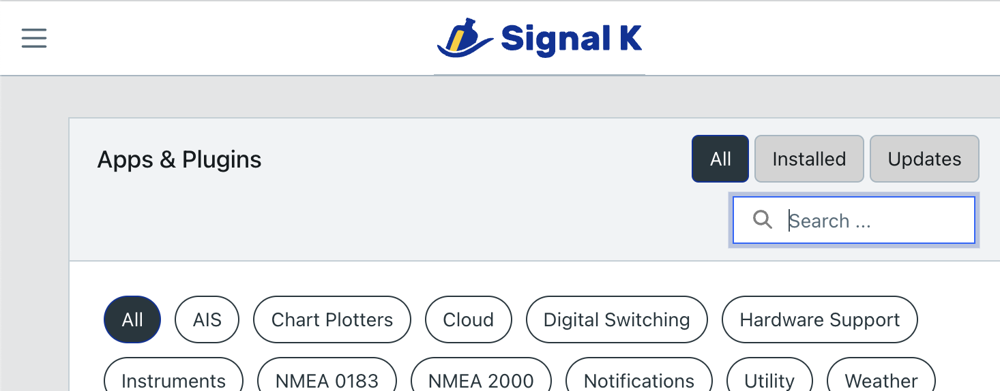
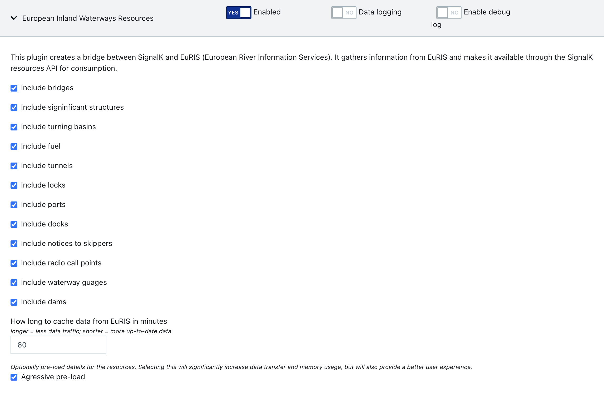
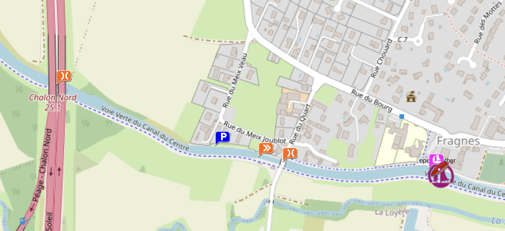

<h3 align="center">SignalK European Inland Waterways (EuRIS) Resources</h3>

---

A plugin for the node.js <a href="https://github.com/SignalK/signalk-server">Signal K server</a> for boats to import points of interest from the <a href = "https://www.eurisportal.eu/api/intro?KL=en">EuRIS API</a> and make these available as resources.
      

## 📝 Table of Contents

- [About](#about)
- [Getting Started](#getting_started)
- [Usage](#usage)
- [Notes](#notes)
- [Authors](#authors)
- [Acknowledgments](#acknowledgement)

## 🧐 About 

 * EuRIS gives you easy access to all information you need as a skipper, vessel owner or logistic operator on the main European waterways.

 * Signal K is an open source server application that runs as a central information hub on a boat. It centralises data, provides a rich API to consume the data, and is extensible through a comprehensive suite of plugins (such as this one) and web applications.

 * Freeboard is a powerful chart plotter web application that runs as a webapp on the Signal K server.

This plugin's purpose is to bring together these 3 components by making information from the EuRIS API available as resources throught the Signal K server which can then be consumed and displayed by Freeboard as an extra layer of information on the chart.

## 🏁 Getting Started 

These instructions will get you up and running.

### Prerequisites

 * A running instance of the Signal K node server with a position source (a GPS).

Instructions [here](https://github.com/SignalK/signalk-server/blob/master/README.md)

### Installing this plugin

Through the Signal K server Appstore, search for signalk-euris-resources, and click the Install button.

### Configuration

In the Signal K menu, head to Server -> Plugin Config, and find European Inland Waterways Resources then enable the plugin. Default values are fine for now, so just click Submit.

## 🎈 Usage 

In the Signal K menu, head to Webapps and launch Freeboard-SK. Enjoy the new information.

## ✍️ Authors 

- [@KvotheBloodless](https://github.com/KvotheBloodless) - Idea & Initial work

See also the list of [contributors](https://github.com/KvotheBloodless/signalk-euris-resources/graphs/contributors) who participated in this project.
